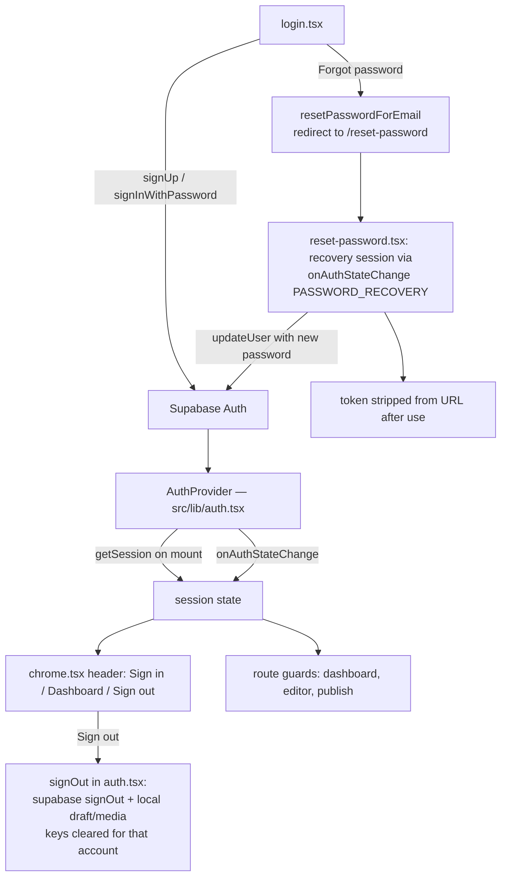
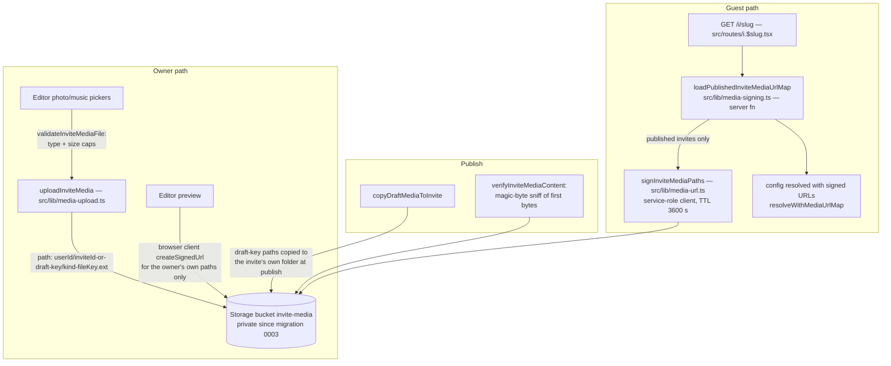

# Architecture — EasyInviteMaker

How the three load-bearing flows work in the current code. Every claim
below names the file it was traced from; where behaviour depends on a
database object, the migration that defines it is named too. Written
2026-10-24 against the `muse-overnight-tasks-2026-10-24` tree.

Stack in one line: TanStack Start (React 19, file routes, Nitro) on
Cloudflare Workers, Supabase (Postgres + Auth + Storage) behind it, and
the self-hosted **YouPI** UPI gateway for payments. Flat price for every
design: ₹599 = 59900 paise, single source `src/config/site.ts`.

---

## 1. Order → payment → webhook → settle → publish

```mermaid
sequenceDiagram
    actor Owner
    participant UI as publish.tsx / youpi-checkout.tsx
    participant API as POST /api/orders (src/routes/api/orders.ts)
    participant DB as Supabase (orders, invites)
    participant YP as YouPI checkout (window.Youpi.pay)
    participant WH as POST /api/webhooks/youpi (src/routes/api/webhooks/youpi.ts)
    participant SRV as src/lib/orders-server.ts
    participant RPC as settle_and_publish RPC (migration 0004)

    Owner->>UI: Publish & pay (₹599)
    UI->>API: POST {userId, inviteId, tier, amountMinor}
    API->>API: verify caller JWT (anon client + caller token), load invite
    API->>API: reject unless invite is draft (409 invite_not_publishable),<br/>no paid order exists (409 invite_already_paid),<br/>amountMinor == 59900 exactly
    API->>DB: reuse live 'created' order or insert a new one<br/>(partial unique index, migration 0005)
    API-->>UI: 201 {orderId, amountMinor: 59900}
    UI->>YP: window.Youpi.pay({ order_id })
    YP-->>WH: webhook (HMAC-signed, payment.success / payment.failed)
    WH->>SRV: verifyWebhookSignature (HMAC + timestamp window)
    WH->>SRV: recordWebhookDelivery (idempotency ledger, migration 0002)
    WH->>SRV: fetchGatewayPayment — corroborate with YouPI<br/>GET /api/v1/payments/{id} (X-Merchant-Key)
    WH->>SRV: fulfilmentPlan(order, payload, gateway, inviteStatus)
    alt plan = settle / settle_and_publish
        WH->>RPC: settleAndPublish(orderId, paymentId)
        RPC->>DB: lock order row then invite row;<br/>settle payment + publish invite atomically
    else plan = publish_only (order already paid, invite still draft)
        WH->>RPC: settleAndPublish(orderId, null) — recovery path
    else plan = mark_failed
        WH->>SRV: markOrderFailed — atomic conditional update;<br/>never overwrites paid/refunded
    else plan = conflict / ignore
        WH->>DB: record the delivery outcome only; invite untouched
    end
    Owner->>UI: lands on /order-success (published link) or /order-failed
```

Key properties, all enforced in code (not convention):

- **The client never sets the price.** `POST /api/orders` compares the
  submitted amount against the server constant and rejects anything
  else; the tier string is accepted but no longer influences price.
- **Auth before money.** The route verifies the caller's Supabase JWT
  and that the invite belongs to them before any order row exists.
- **The webhook is the only fulfilment path.** The browser returning
  from YouPI changes nothing by itself. Fulfilment requires: a valid
  HMAC signature, a fresh timestamp, a delivery not already recorded,
  and the gateway's own record agreeing with the webhook payload
  (`amountMatches`, `payloadCurrencyMismatch` in
  `src/lib/orders-server.ts`).
- **Settlement is atomic.** `settle_and_publish` (migration 0004,
  SECURITY INVOKER, EXECUTE revoked from public/anon/authenticated and
  granted to `service_role` only) locks the order row, then the invite
  row, and flips both in one transaction — this is what closes the
  refund-vs-publication race an update-by-update flow could not.
- **Terminal states are sticky.** `refunded` can never be overwritten
  by a late success or failure event; a success arriving for a refunded
  order is answered truthfully and the invite is never published.
  Refunds themselves are owner actions at the YouPI portal — no app
  code writes `refunded`.
- **Invite status is guarded in the database.** Migration 0006 adds a
  BEFORE INSERT/UPDATE trigger so a signed-in user cannot flip their
  own invite to `published` through the row-level-security policy —
  publication only happens via the service-role settle path above.

## 2. Auth flow



- Two Supabase clients exist and are never interchanged:
  `src/lib/supabase.ts` (browser, publishable key, RLS-bound — used for
  all owner reads/writes and auth) and `src/lib/supabase-server.ts`
  (service role, server-only — used by API routes and the webhook;
  it bypasses RLS, which is why the payment code re-checks ownership
  and state itself).
- Provider error strings are never shown raw: login/signup errors are
  sanitized before display.
- Signing out (or signing in as a different user) clears the previous
  account's local draft and media keys, so a draft never leaks across
  accounts on a shared browser. An anonymous → first-sign-in transition
  keeps the draft the visitor just made.
- The reset flow depends on one owner-side setting: `/reset-password`
  must be allow-listed in Supabase Auth redirect URLs, or the recovery
  link lands nowhere useful.

## 3. Media: upload → storage → signed URLs



- **Content is verified, not trusted.** Uploads are checked by file
  signature (magic bytes, `sniffMediaKind`) in addition to extension
  and size — a renamed file does not pass.
- **Nothing public is ever linked.** Since migration 0003 the bucket
  is private; the guest page receives one-hour signed URLs minted
  server-side (`MEDIA_SIGNED_URL_TTL_SECONDS = 3600` in
  `src/lib/media-url.ts`), and only for invites whose status is
  `published`. Draft media is never signed for guests.
- **Deploy order matters.** The editor's owner-side signing (above)
  must be deployed *before* migration 0003 is applied — under the old
  public-URL code the editor preview would break the moment the bucket
  goes private. Full sequence: `docs/ops/MEDIA-DEPLOY-SEQUENCE.md`.
- Shortfalls are loud, not silent: `reportMediaSigningShortfall` logs
  any path that failed to sign so a broken guest image is diagnosable
  from server logs.

---

## Where to read next

- Money internals and their invariants: `src/lib/orders-server.ts`
  (the header comment is the design note) and
  `docs/ops/ADR-settle-and-publish.md`.
- Launch gating and deploy order: `docs/ops/DEPLOYMENT.md`,
  `docs/ops/RELEASE-CHECKLIST.md`, `docs/ops/RLS-VERIFICATION.sql`.
- Security model: `docs/ops/SECURITY-REVIEW.md`.
